# 网络海鲜市场

> 🎓 **计算机毕业设计 · 网络海鲜市场**
>
> 本仓库只放**项目介绍 + 运行截图**（截图是站点带水印的原图，存在仓库 `images/` 里）。
>
> 👉 **完整可运行源码 / 数据库脚本 / 部署文档：[点我获取](https://geekcode.top/archives/%E7%BD%91%E7%BB%9C%E6%B5%B7%E9%B2%9C%E5%B8%82%E5%9C%BA?utm_source=github)**
>
> 💬 咨询微信：**ir9372**　|　🌐 更多项目：[极客代码 geekcode.top](https://geekcode.top/?utm_source=github)
>
> 📌 项目详情页：<https://geekcode.top/archives/%E7%BD%91%E7%BB%9C%E6%B5%B7%E9%B2%9C%E5%B8%82%E5%9C%BA?utm_source=github>

<table><td width="230" align="center"> <b>扫码加微信 ir9372</b></td><td valign="middle">📦 源码 = 项目介绍 + 全部运行截图 + 数据库 + 部署文档 👉 点上方任意截图，直接跳到 <b>极客代码 geekcode.top</b> 详情页</td></table>

---

<h1>网络海鲜市场</h1>
<h2>项目概述</h2>

本项目名为“网络海鲜市场”，是一个基于 Vue 与 Spring Boot 前后端分离架构开发的综合性电子商务平台。项目旨在解决传统海鲜交易信息不对称、流通效率低的问题，为商家提供在线展示与销售渠道，为消费者提供便捷的商品选购与秒杀体验。系统核心功能涵盖商品信息浏览、分类检索、限时秒杀、商城资讯发布及订单管理等模块。适用人群包括海鲜产品供应商（商家）、普通消费者以及平台管理员。技术架构上采用后端 Spring Boot 结合 MyBatis-Plus 进行数据持久化，使用 Apache Shiro 实现权限控制；前端基于 Vue 框架构建，实现了前台用户交互界面与后台管理界面的完整闭环，具备良好的可扩展性与维护性。

<h2>技术架构</h2>
<h3>1. 总体架构设计</h3>

项目采用经典的前后端分离模式。后端作为服务提供方，负责业务逻辑处理、数据访问及接口暴露；前端作为视图层，通过 HTTP 请求与后端交互，渲染用户界面。

<a href="https://geekcode.top/archives/%E7%BD%91%E7%BB%9C%E6%B5%B7%E9%B2%9C%E5%B8%82%E5%9C%BA?utm_source=github" title="查看完整源码">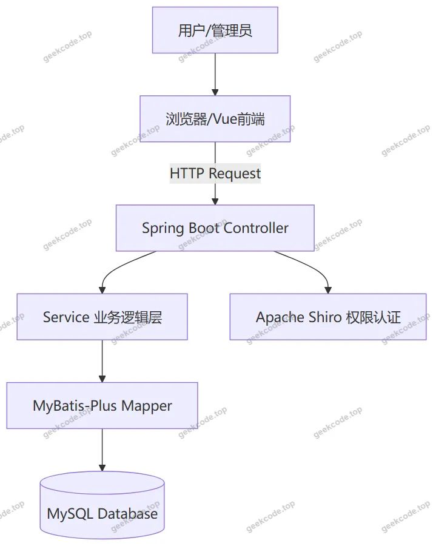</a>

<h3>2. 核心技术选型</h3>
<ul>
<li><strong>后端框架</strong>：使用 <code>spring-boot-starter-web</code> 构建 RESTful API，简化配置并快速启动应用。</li>
<li><strong>数据持久层</strong>：集成 <code>mybatis-spring-boot-starter</code> 和 <code>mybatis-plus</code>，利用 MyBatis-Plus 提供的通用 CRUD 操作简化 SQL 编写，提高开发效率。数据库连接池采用 <code>spring-boot-starter-jdbc</code>，驱动为 <code>mysql-connector-java</code>。</li>
<li><strong>安全框架</strong>：引入 <code>shiro-spring</code> 实现身份验证（Authentication）和授权（Authorization），保障系统安全性。</li>
<li><strong>工具类库</strong>：使用 <code>commons-lang3</code> 提供字符串处理等常用工具，<code>validation-api</code> 用于参数校验，<code>protobuf-java</code> 支持高效的数据序列化需求。</li>
</ul>
<h3>3. 数据库设计要点</h3>

数据库基于 MySQL 关系型模型设计，主要实体包括商品、用户、商家、订单、评论、资讯等。通过外键关联或业务 ID 映射实现表间联系，确保数据一致性。例如，<code>OrdersController</code> 处理订单状态流转，<code>MiaoshashangpinController</code> 处理秒杀商品库存扣减逻辑，需保证事务的原子性。

<h2>功能模块</h2>

根据源码中的 Controller 列表及路由配置，系统功能划分为前台用户端和后台管理端。

<h3>1. 前台用户端</h3>

前台主要面向消费者，提供商品浏览、购买及互动功能。

<ul>
<li><strong>首页展示</strong>：聚合推荐商品、最新秒杀活动及热门资讯，引导用户进入具体板块。</li>
<li><strong>商品信息模块</strong> (<code>Shangpinxinxi</code>)：</li>
<li>商品列表浏览：支持分页展示所有上架海鲜商品。</li>
<li>商品详情查看：展示商品图片、描述、价格及库存。</li>
<li>商品分类筛选：通过 <code>Shangpinfenlei</code> 接口获取分类树，支持按类别检索。</li>
<li>商品评论：用户可对已购商品发表评价 (<code>Discussshangpinxinxi</code>)。</li>
<li><strong>秒杀商品模块</strong> (<code>Miaoshashangpin</code>)：</li>
<li>秒杀专区：展示限时特价海鲜商品。</li>
<li>秒杀抢购：高并发场景下的下单流程。</li>
<li>秒杀评论：用户对秒杀商品的反馈 (<code>Discussmiaoshashangpin</code>)。</li>
<li><strong>商城资讯模块</strong> (<code>News</code>)：展示平台发布的行业新闻、促销公告等内容。</li>
<li><strong>关于我们</strong> (<code>Aboutus</code>)：展示平台介绍、联系方式等信息。</li>
<li><strong>个人中心</strong>：</li>
<li>虽然导航菜单未显式列出详细子项，但代码中存在 <code>AddressController</code>（收货地址管理）、<code>CartController</code>（购物车管理）及 <code>Yonghu</code>（用户信息管理）相关逻辑，支撑用户的日常购物行为。</li>
<li>收藏功能：截图显示有“收藏列表”，对应后端可能有相应的收藏接口（虽未在 Controller 列表中明确命名，但通常集成在商品或用户模块中）。</li>
</ul>
<h3>2. 后台管理端</h3>

后台面向管理员和商家，提供全量数据管理与运营配置功能。

<ul>
<li><strong>登录页</strong>：基于 Shiro 的安全认证入口。</li>
<li><strong>用户管理</strong> (<code>/yonghu</code>)：查看、编辑、禁用前台注册用户账号。</li>
<li><strong>商家管理</strong> (<code>/shangjia</code>)：审核入驻商家资质，管理商家信息。</li>
<li><strong>商品管理</strong>：</li>
<li>商品信息 (<code>/shangpinxinxi</code>)：上架、下架、修改商品详情及库存。</li>
<li>商品分类 (<code>/shangpinfenlei</code>)：维护海鲜产品的分类体系。</li>
<li>秒杀商品 (<code>/miaoshashangpin</code>)：配置秒杀活动时间、数量及价格。</li>
<li><strong>订单管理</strong> (<code>/orders/:status</code>)：根据不同状态（如待支付、已发货、已完成）查询和处理订单。</li>
<li><strong>内容管理</strong>：</li>
<li>商城资讯 (<code>/news</code>)：发布、编辑、删除平台新闻公告。</li>
<li>关于我们 (<code>/aboutus</code>)：更新平台简介页面内容。</li>
<li><strong>评论管理</strong>：</li>
<li>商品评论 (<code>/discussshangpinxinxi</code>)：审核或删除违规用户评论。</li>
<li>秒杀评论 (<code>/discussmiaoshashangpin</code>)：管理秒杀活动的用户反馈。</li>
<li><strong>系统配置</strong> (<code>/config</code>)：管理平台基础参数设置。</li>
</ul>
<h2>用户角色与权限</h2>

系统基于 Apache Shiro 实现细粒度的权限控制，主要包含以下三类角色：

<table>
<thead>
<tr>
<th align="left">角色名称</th>
<th align="left">描述</th>
<th align="left">可访问的功能模块</th>
</tr>
</thead>
<tbody><tr>
<td align="left"><strong>超级管理员</strong></td>
<td align="left">平台最高权限拥有者</td>
<td align="left"><strong>全部后台功能</strong>：1. 用户管理2. 商家管理3. 所有商品管理（含秒杀）4. 订单全流程管理5. 内容与资讯管理6. 评论审核7. 系统配置</td>
</tr>
<tr>
<td align="left"><strong>商家</strong></td>
<td align="left">海鲜产品供应商</td>
<td align="left"><strong>受限后台功能</strong>：1. 自身店铺的商品信息管理（增删改查）2. 自身店铺的秒杀商品配置3. 自身店铺的订单查看与处理4. 自身商品评论查看*(注：具体隔离策略取决于后端代码中对 Shangjia 角色的权限拦截实现)*</td>
</tr>
<tr>
<td align="left"><strong>普通用户</strong></td>
<td align="left">消费者</td>
<td align="left"><strong>前台功能</strong>：1. 浏览首页、资讯、关于页面2. 搜索与浏览商品及秒杀商品3. 加入购物车、提交订单4. 管理个人收货地址5. 查看与管理个人收藏6. 发表商品及秒杀评论7. 查看个人订单历史</td>
</tr>
</tbody></table>

<em>说明：若存在未注册访客，仅允许浏览公开信息（首页、商品列表、资讯），无法进行下单、评论或访问个人中心。</em>

<h2>项目特色与创新点</h2>
<ol>
<li><strong>垂直领域电商解决方案</strong>：针对海鲜产品易腐、时效性强的特点，设计了专门的“秒杀商品”模块，通过限时限量机制促进高频次消费，优化库存周转率。</li>
<li><strong>完善的互动社区机制</strong>：不仅支持普通商品评论，还独立设计了秒杀商品评论模块 (<code>Discussmiaoshashangpin</code>)，便于用户对特殊营销活动进行针对性反馈，增强用户参与感。</li>
<li><strong>标准化的前后端分离架构</strong>：采用 Vue + Spring Boot 主流技术栈，接口定义清晰（RESTful），便于后续移动端适配或第三方系统集成。</li>
<li><strong>灵活的内容运营体系</strong>：内置“商城资讯” (<code>News</code>) 和“关于我们” (<code>Aboutus</code>) 模块，使平台不仅是交易场所，也是品牌宣传与信息发布的窗口，提升了平台的综合服务能力。</li>
<li><strong>健壮的安全防护</strong>：集成 Apache Shiro 框架，有效防止越权访问，保护用户隐私及商业数据安全。</li>
</ol>
<h2>部署环境</h2>

为确保项目正常运行，需准备以下软硬件环境：

<ul>
<li><strong>操作系统</strong>：Windows 10/11, Linux (CentOS 7+), 或 macOS。</li>
<li><strong>JDK 版本</strong>：Java Development Kit 8 或 Java 11（推荐 JDK 8，兼容性好且稳定）。</li>
<li><strong>数据库</strong>：MySQL 5.7 或 MySQL 8.0。需初始化数据库表结构及基础数据。</li>
<li><strong>Web 服务器</strong>：内置 Tomcat（由 Spring Boot Starter Web 提供），生产环境建议配合 Nginx 进行反向代理。</li>
<li><strong>前端运行环境</strong>：Node.js (LTS 版本，如 v14.x 或 v16.x) 及 npm/yarn 包管理器，用于编译 Vue 前端代码。</li>
<li><strong>开发工具</strong>：IntelliJ IDEA (后端), VS Code (前端), Navicat/DBeaver (数据库管理)。</li>
</ul>
<h2>五、技术特性</h2>
<ul>
<li>前后端集成部署，前端资源打包至后端 static 目录</li>
<li>使用 MyBatis-Plus 简化数据访问层开发</li>
<li>集成 Shiro 权限框架实现角色权限控制</li>
</ul>
<h2>六、功能模块截图</h2>
<h3>前台用户端</h3>
<h4>前台-秒杀商品列表</h4>

<a href="https://geekcode.top/archives/%E7%BD%91%E7%BB%9C%E6%B5%B7%E9%B2%9C%E5%B8%82%E5%9C%BA?utm_source=github" title="查看完整源码">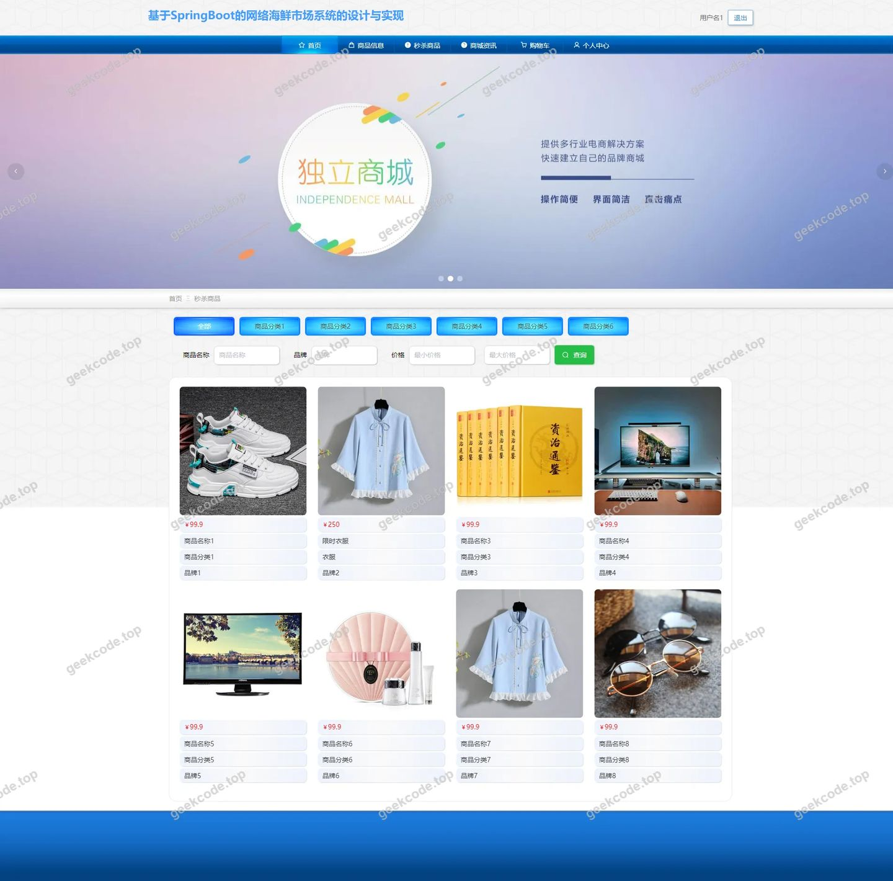</a>

<h4>前台-商家列表</h4>

<h4>前台-商品分类列表</h4>

<a href="https://geekcode.top/archives/%E7%BD%91%E7%BB%9C%E6%B5%B7%E9%B2%9C%E5%B8%82%E5%9C%BA?utm_source=github" title="查看完整源码">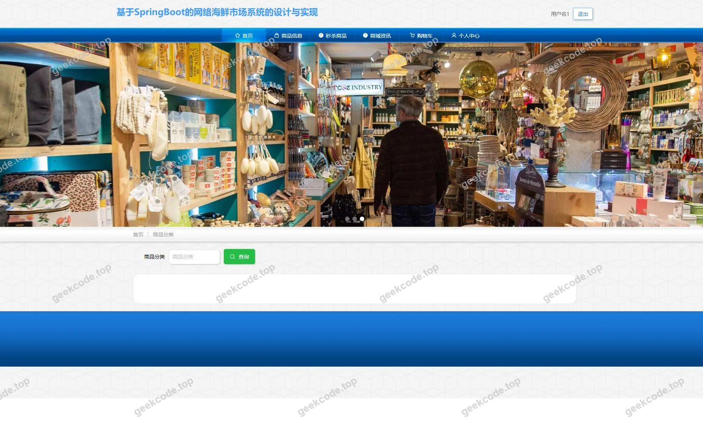</a>

<h4>前台-商品信息列表</h4>

<a href="https://geekcode.top/archives/%E7%BD%91%E7%BB%9C%E6%B5%B7%E9%B2%9C%E5%B8%82%E5%9C%BA?utm_source=github" title="查看完整源码">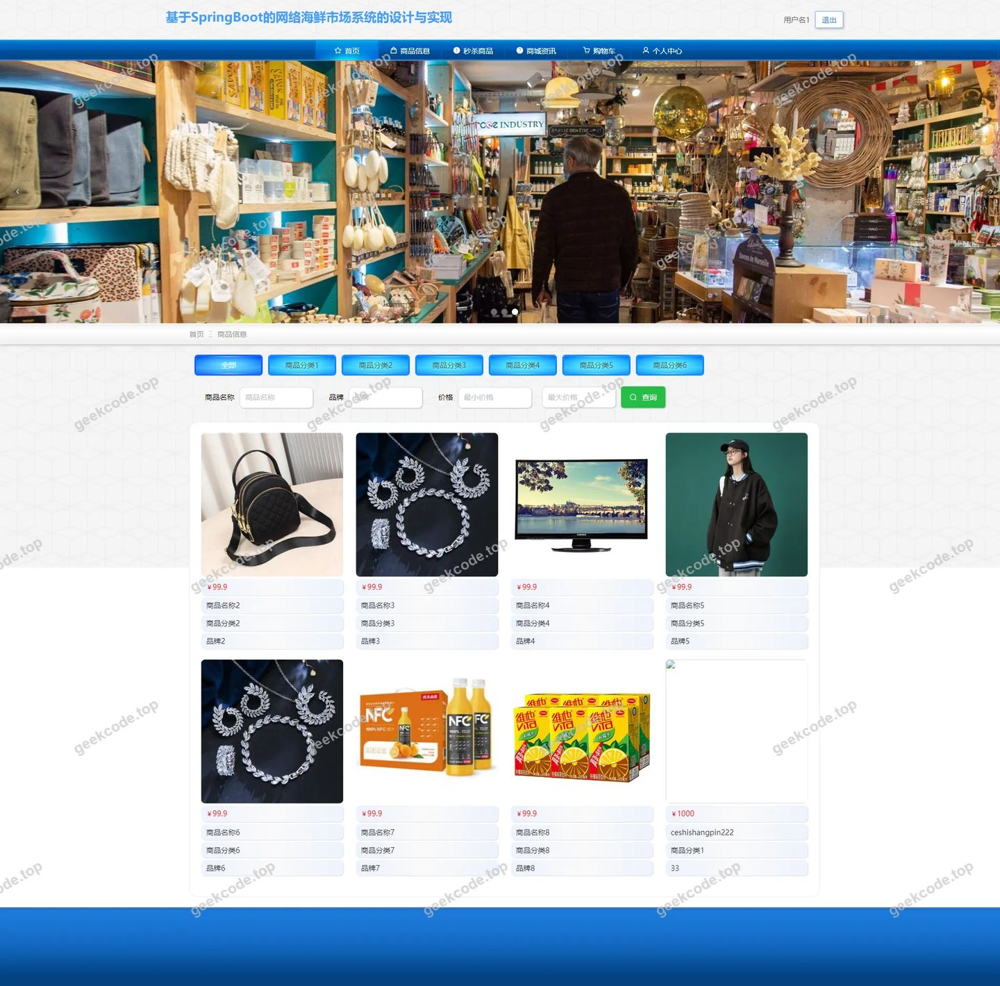</a>

<h4>前台-收藏列表</h4>

<a href="https://geekcode.top/archives/%E7%BD%91%E7%BB%9C%E6%B5%B7%E9%B2%9C%E5%B8%82%E5%9C%BA?utm_source=github" title="查看完整源码">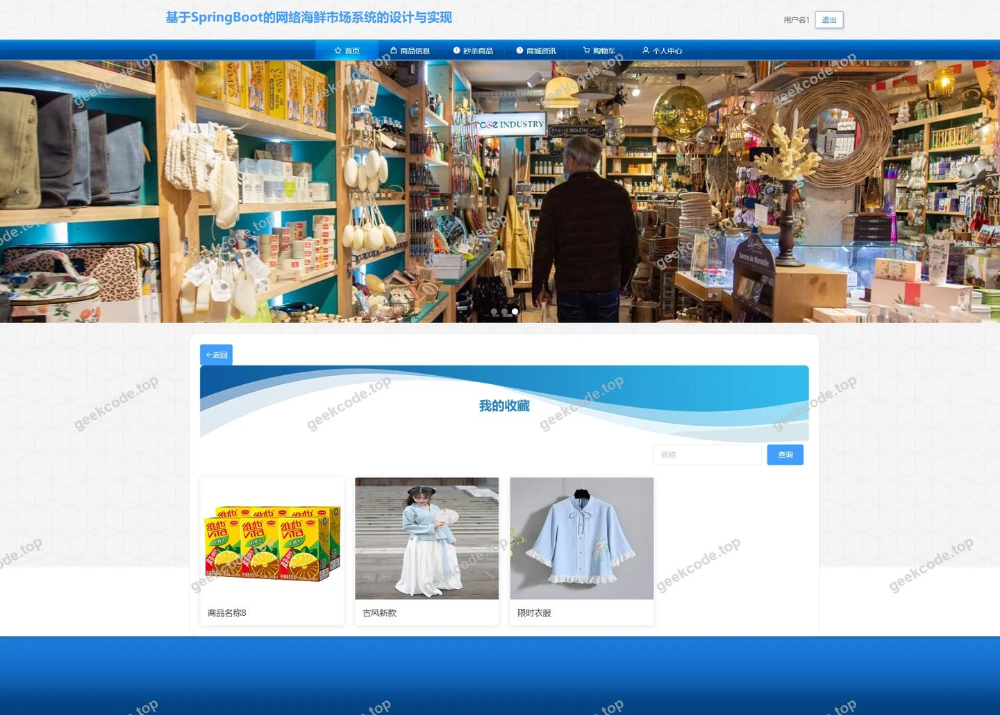</a>

<h4>前台-个人中心</h4>

<h4>前台-公告列表</h4>

<h3>后台管理端</h3>
<h4>后台-登录页</h4>

<a href="https://geekcode.top/archives/%E7%BD%91%E7%BB%9C%E6%B5%B7%E9%B2%9C%E5%B8%82%E5%9C%BA?utm_source=github" title="查看完整源码">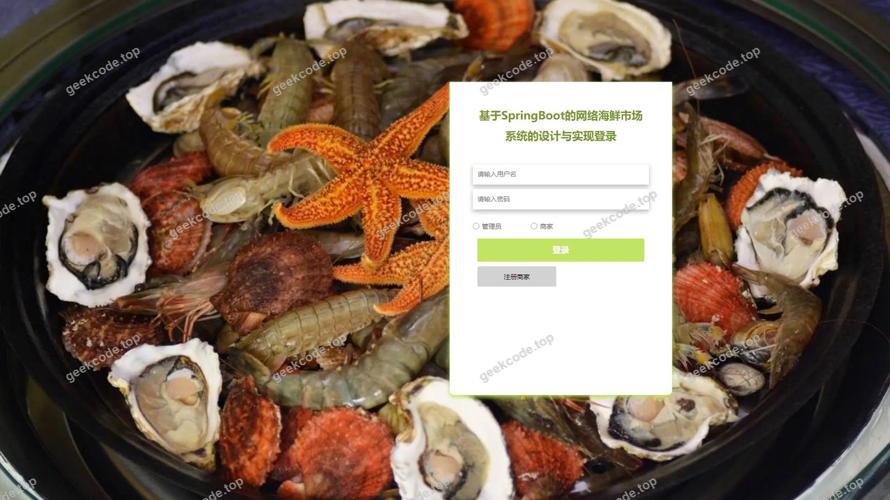</a>

<h4>后台-订单管理</h4>

<a href="https://geekcode.top/archives/%E7%BD%91%E7%BB%9C%E6%B5%B7%E9%B2%9C%E5%B8%82%E5%9C%BA?utm_source=github" title="查看完整源码">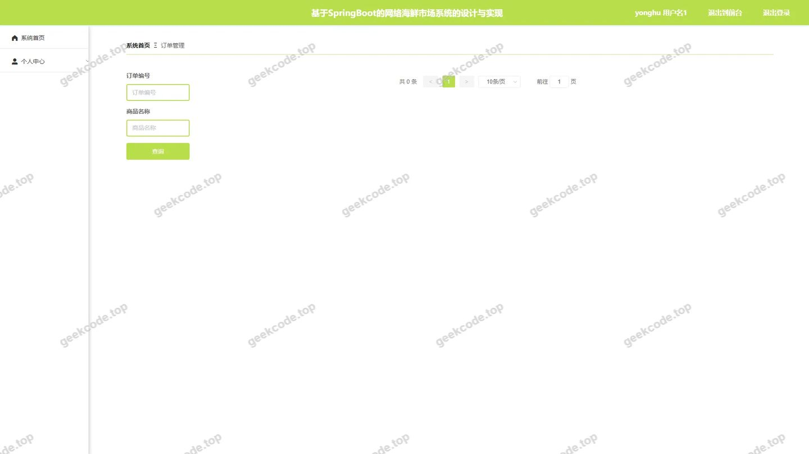</a>

<h4>后台-关于我们</h4>

<a href="https://geekcode.top/archives/%E7%BD%91%E7%BB%9C%E6%B5%B7%E9%B2%9C%E5%B8%82%E5%9C%BA?utm_source=github" title="查看完整源码">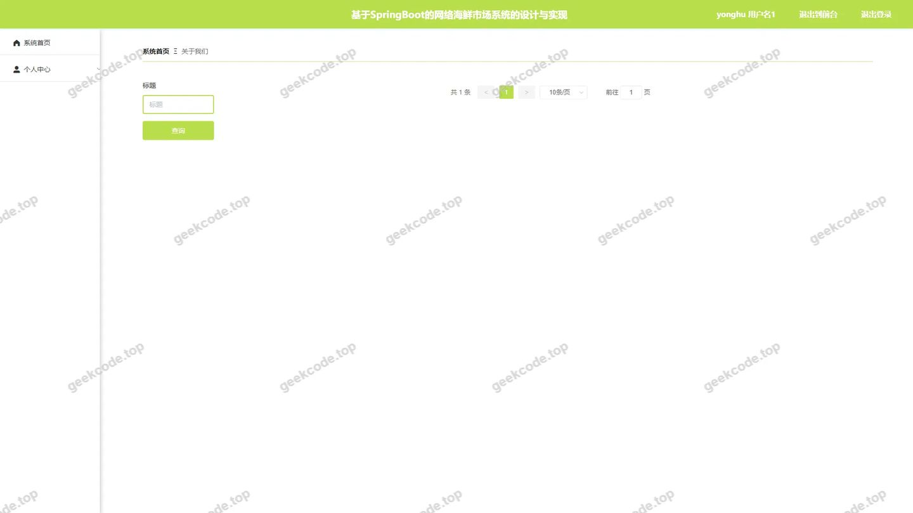</a>

<h4>后台-秒杀商品</h4>

<a href="https://geekcode.top/archives/%E7%BD%91%E7%BB%9C%E6%B5%B7%E9%B2%9C%E5%B8%82%E5%9C%BA?utm_source=github" title="查看完整源码">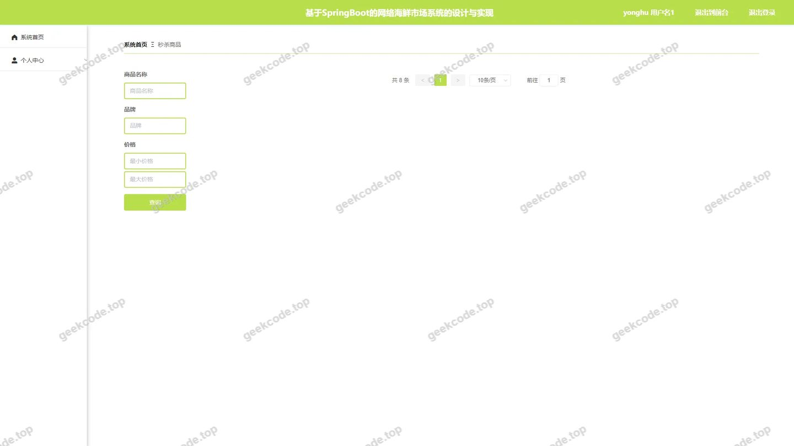</a>

<h4>后台-秒杀商品评论</h4>

<a href="https://geekcode.top/archives/%E7%BD%91%E7%BB%9C%E6%B5%B7%E9%B2%9C%E5%B8%82%E5%9C%BA?utm_source=github" title="查看完整源码">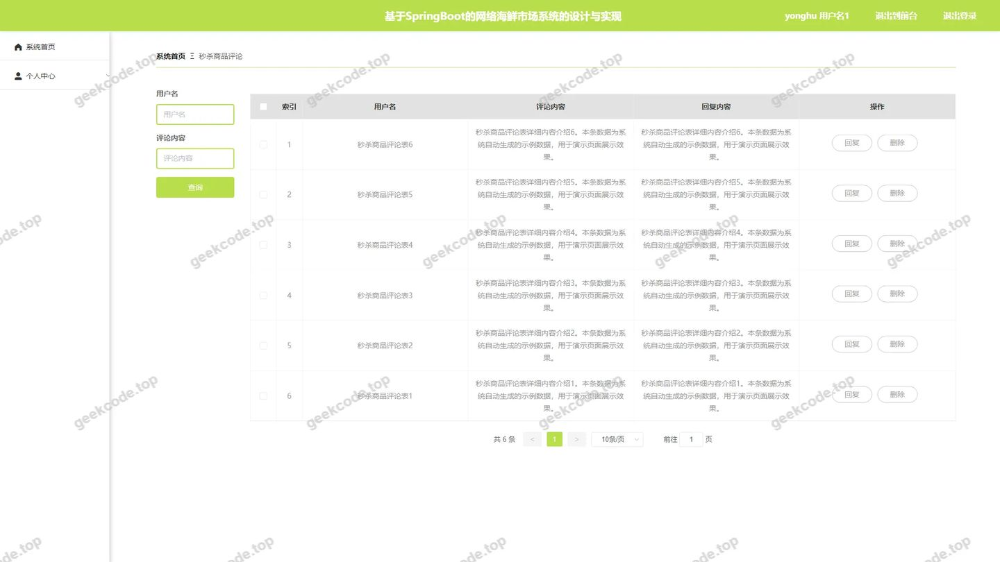</a>

<h4>后台-商城资讯</h4>

<h4>后台-商品分类</h4>

<a href="https://geekcode.top/archives/%E7%BD%91%E7%BB%9C%E6%B5%B7%E9%B2%9C%E5%B8%82%E5%9C%BA?utm_source=github" title="查看完整源码">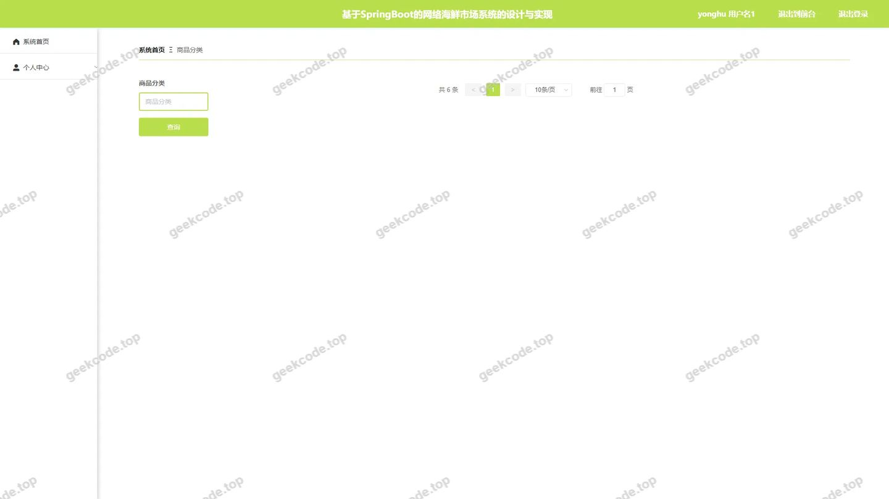</a>

<h4>后台首页</h4>

<a href="https://geekcode.top/archives/%E7%BD%91%E7%BB%9C%E6%B5%B7%E9%B2%9C%E5%B8%82%E5%9C%BA?utm_source=github" title="查看完整源码">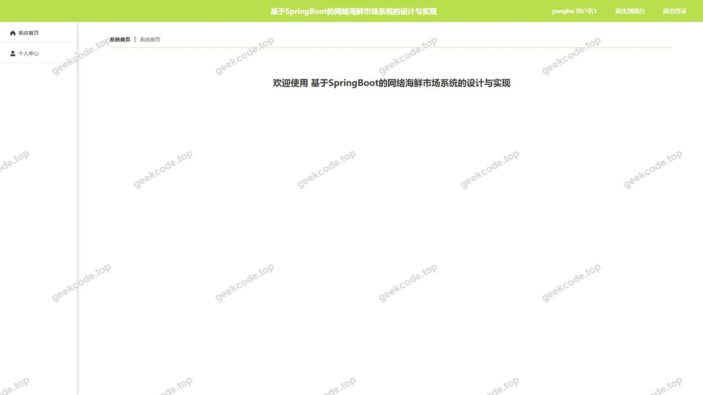</a>

<h4>后台-用户</h4>

<a href="https://geekcode.top/archives/%E7%BD%91%E7%BB%9C%E6%B5%B7%E9%B2%9C%E5%B8%82%E5%9C%BA?utm_source=github" title="查看完整源码">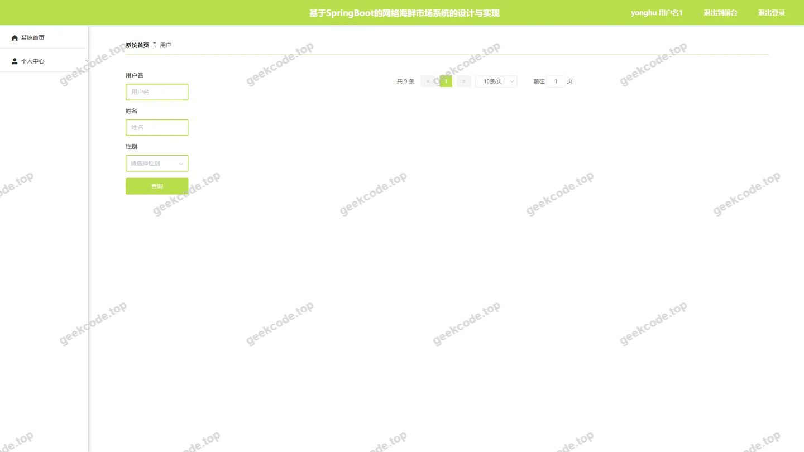</a>

---

## 获取完整源码

| 项目 | 说明 |
| --- | --- |
| 项目名 | 网络海鲜市场 |
| 运行截图 | 本文 17 张（站点带水印原图，仓库 `images/` 目录） |
| 完整源码 | [https://geekcode.top/archives/%E7%BD%91%E7%BB%9C%E6%B5%B7%E9%B2%9C%E5%B8%82%E5%9C%BA?utm_source=github](https://geekcode.top/archives/%E7%BD%91%E7%BB%9C%E6%B5%B7%E9%B2%9C%E5%B8%82%E5%9C%BA?utm_source=github) |
| 咨询微信 | **ir9372**（备注：jingpin-yuanma） |
| 更多项目 | [极客代码 geekcode.top](https://geekcode.top/?utm_source=github) |

> 需要源码、部署、改配置、跑不起来等问题，加微信 ir9372 沟通，说明项目名即可。
